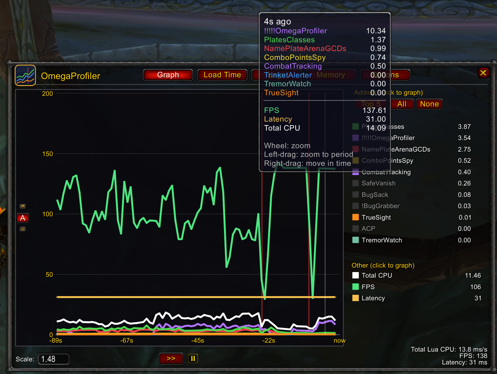
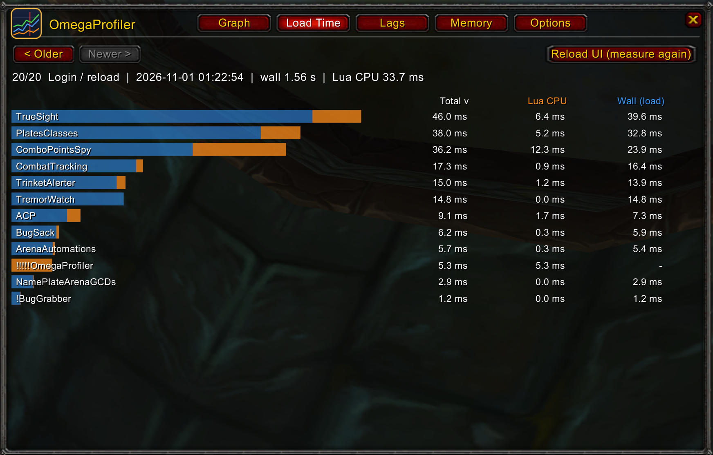
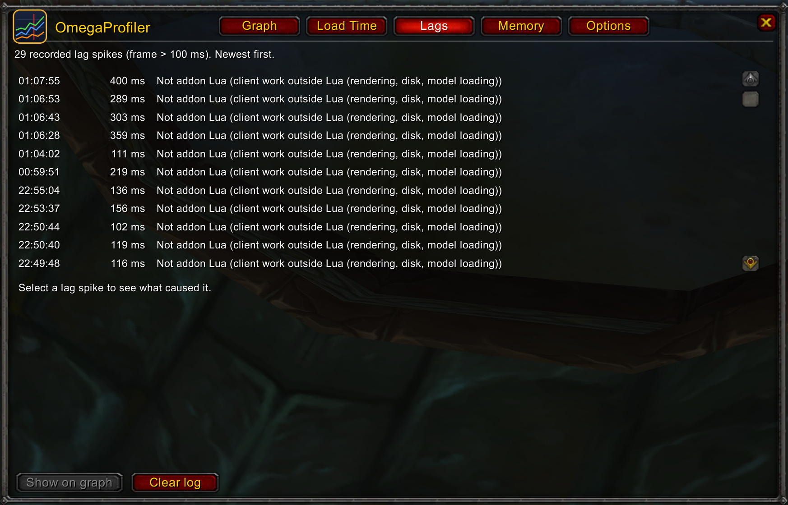
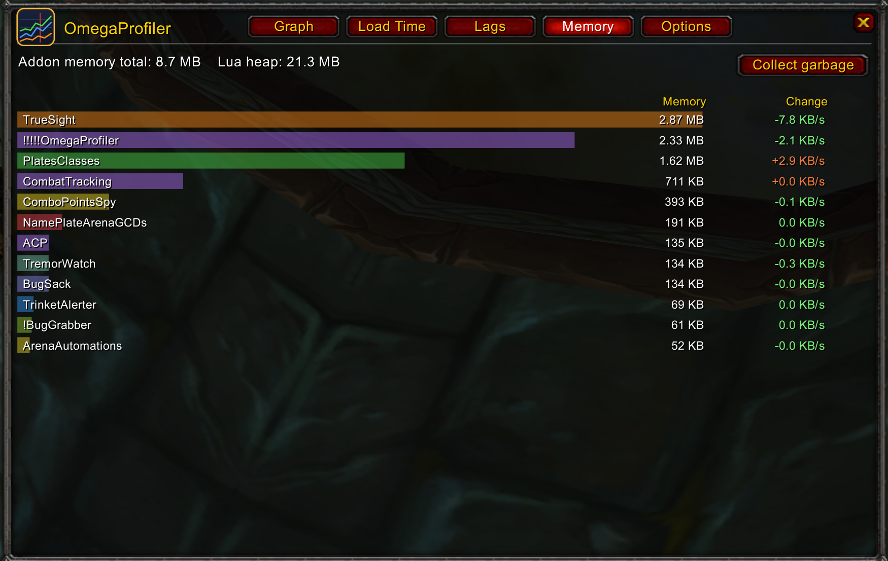
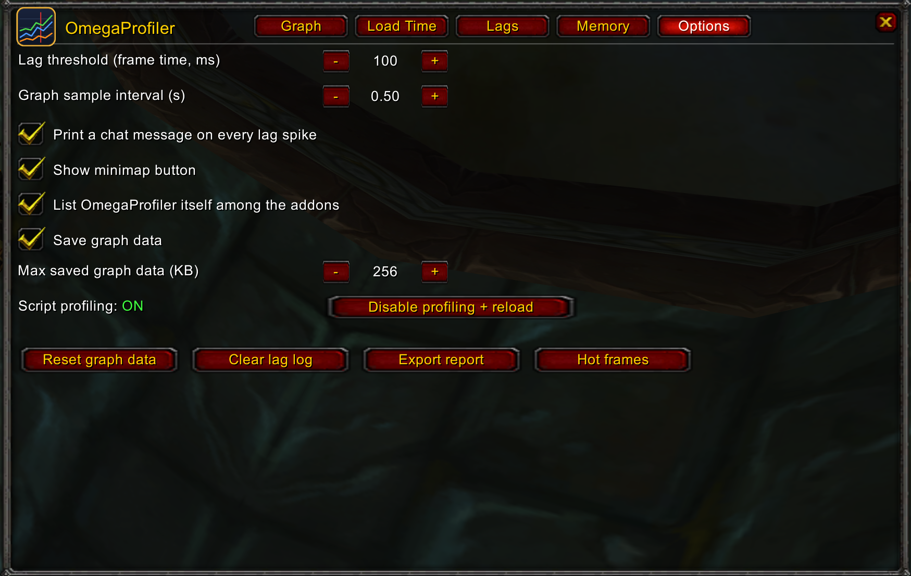

# OmegaProfiler

Addon profiler for World of Warcraft 3.3.5a (build 12340): which addons use CPU, how long each takes to load, and what
caused a lag spike.

## Features
- **Graph:** CPU per addon (ms of Lua per second) over time, plus total CPU, FPS and latency. Zoom with the wheel,
  drag to zoom to a period, right-drag to move in time. Keeps up to 24 h at decreasing detail.
- **Load Time:** each addon's load cost (Lua CPU and wall time) at login/`/reload`, and its CPU during zone loading
  screens. History of the last 50 loads.
- **Lags:** logs frames over a threshold (default 100 ms) that are also much longer than the recent frames, with the
  likely cause: the addons that ran during the frame, garbage collection, a latency jump or the client itself.
- **Memory:** memory and its growth rate per addon.
- **Options:** lag threshold and chat alert, sample interval, minimap button, saved data size, a copyable text report
  and a "hot frames" list (frames whose scripts use the most CPU).
- Graph, lag log and load history survive `/reload` and relog.

| Load time | Lags |
|---|---|
|  |  |
| **Memory** | **Options** |
|  |  |

## Installation
1. Download the zip from [Releases](https://github.com/BannZay/OmegaProfiler/releases).
2. Extract it to `World of Warcraft\Interface\AddOns\`, keeping the folder name `!!!!!OmegaProfiler`: the `!` prefix
   makes it load first, so it can time the addons loaded after it.
3. Type `/omp enable` in game. This turns on the client's `scriptProfile` setting and reloads the UI. Without it only
   wall load times, FPS, latency, memory and lag durations are measured, not CPU per addon.
   Profiling slows the UI a little: type `/omp disable` when you are done.

## Commands
| Command | Action |
|---|---|
| `/omp` or `/profiler` | Show or hide the window |
| `/omp lags` / `/omp load` | Open the Lags / Load Time tab |
| `/omp reset` | Clear the graph data |
| `/omp enable` / `/omp disable` | Turn CPU profiling on / off (reloads the UI) |

Minimap button: left click opens the window, right click opens Lags, drag moves it.

## Limits
- CPU is measured per addon, not per function. Time spent by the game itself (rendering, loading models) shows as
  "not addon Lua".
- Load wall time is the time between one addon finishing loading and the next one; addons loaded before
  OmegaProfiler are not timed.

## Development
Offline tests for the pure-Lua modules (`Series`, `Persist`, `Classify`, `Pack`), Lua 5.1, no game needed:

    lua tests/test_offline.lua

## License
[MIT](LICENSE)
